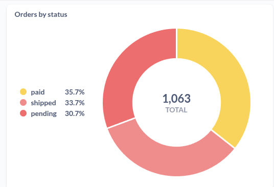
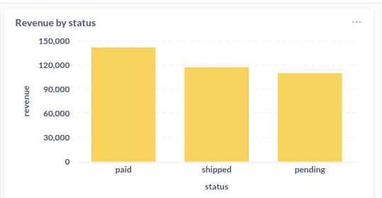
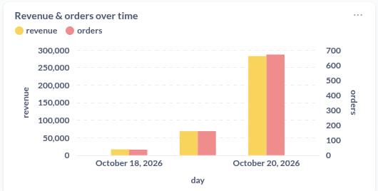
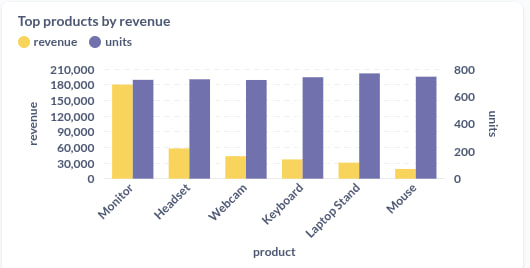
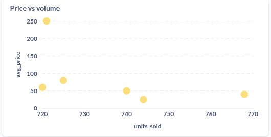
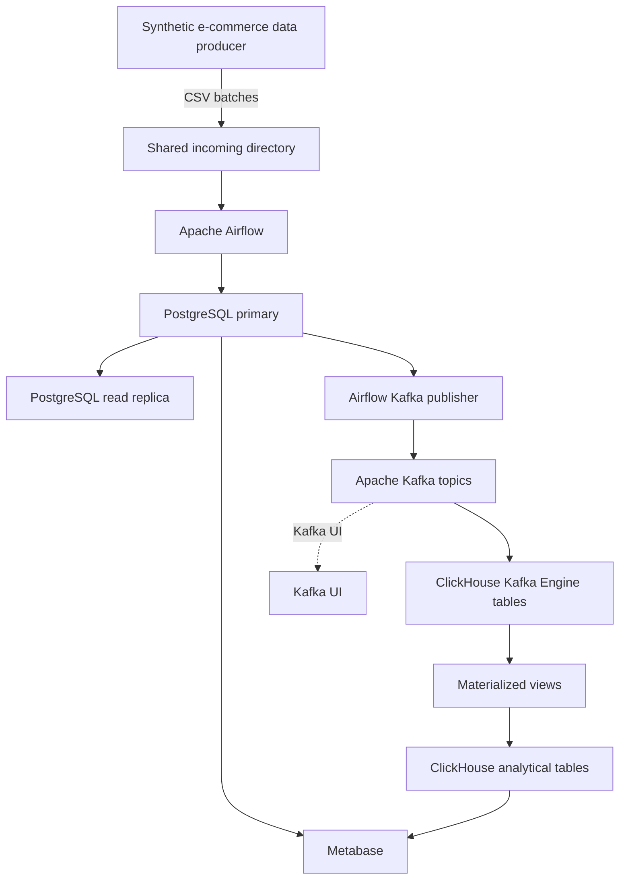

# E-Commerce Data Engineering Pipeline

An end-to-end, containerized e-commerce data engineering project that brings together **Apache Airflow, PostgreSQL, Apache Kafka, ClickHouse, and Metabase**. It demonstrates batch data generation and ingestion, relational storage, PostgreSQL replication, event streaming, analytical storage, and dashboarding in one local development environment.

The repository is designed as a hands-on data engineering portfolio project: the components run in Docker Compose, the ingestion workflows are defined as Airflow DAGs, and the resulting data can be explored through Metabase.

## Analytics dashboards

The following charts were built in Metabase using the project's e-commerce data.

<table>
  <tr>
    <td width="50%">
      <strong>Orders by status</strong><br>
      
    </td>
    <td width="50%">
      <strong>Revenue by order status</strong><br>
      
    </td>
  </tr>
  <tr>
    <td width="50%">
      <strong>Revenue and orders over time</strong><br>
      
    </td>
    <td width="50%">
      <strong>Top products by revenue</strong><br>
      
    </td>
  </tr>
  <tr>
    <td colspan="2">
      <strong>Price versus sales volume</strong><br>
      
    </td>
  </tr>
</table>

## Architecture



### Data flow

1. **Generate data.** A lightweight Python producer creates timestamped CSV batches for users, products, orders, and order items. It writes temporary files first and atomically renames them when publishing, helping prevent the ingestion process from reading a partially written file.
2. **Orchestrate ingestion.** Airflow discovers complete batches and triggers entity-specific DAGs. Users and products are ingested before orders, followed by order items, so the foreign-key dependencies are respected.
3. **Store operational data.** PostgreSQL holds the relational source tables and enforces primary keys, foreign keys, uniqueness, and value constraints.
4. **Replicate PostgreSQL.** A primary/replica setup uses PostgreSQL streaming replication to maintain a read replica.
5. **Publish changes to Kafka.** The `kafka_publisher` DAG reads rows newer than per-entity watermarks and publishes JSON messages to topics such as `ecommerce.users` and `ecommerce.orders`.
6. **Build analytical tables.** ClickHouse Kafka Engine tables consume Kafka topics. Materialized views convert incoming JSON fields to appropriate types and insert them into MergeTree-family analytical tables.
7. **Explore the data.** Metabase connects to PostgreSQL and ClickHouse for querying and visualization. Kafka UI provides a browser interface for inspecting Kafka.

> **Scope note:** The repository contains additional CDC-related scripts, but the Debezium/Kafka Connect configuration they reference is not included in this archive. The documented core flow above describes the Airflow publisher → Kafka → ClickHouse path.

## Technology stack

| Technology | Role in the project |
|---|---|
| Docker Compose | Runs the services in a reproducible local environment |
| Apache Airflow 2.10.5 | Schedules and orchestrates ingestion and publishing DAGs |
| PostgreSQL 16 | Relational source database and primary/replica replication |
| Apache Kafka 4.1.1 | Event-streaming broker for e-commerce records |
| ClickHouse 25.3 | Analytical storage and Kafka-backed ingestion |
| Metabase 0.50.21 | SQL exploration and dashboarding |
| Kafka UI | Browser-based Kafka topic and cluster inspection |
| Python | Synthetic data generation and Airflow task logic |

## Features

- **Batch-based CSV ingestion** for users, products, orders, and order items.
- **Coordinated Airflow DAGs** that process a shared batch in dependency order.
- **Input validation** for required CSV columns and empty files.
- **Idempotent database writes** using PostgreSQL conflict handling.
- **Failure handling** that rolls back failed transactions and moves failed input files to a quarantine directory.
- **PostgreSQL constraints** for data integrity, including foreign keys and positive quantities/prices.
- **PostgreSQL primary/replica configuration** using streaming replication.
- **Watermark-based Kafka publishing** to track progress per entity.
- **ClickHouse Kafka Engine and materialized views** for streaming ingestion and type conversion.
- **Metabase dashboards** for order status, revenue, sales over time, product performance, and price/volume comparisons.
- **Dockerized local services** to make the environment easier to reproduce and extend.

## Repository structure

```text
.
├── docker-compose.yml
├── airflow-stack/
│   ├── Dockerfile
│   ├── dags/
│   │   ├── ecommerce_ingestion.py
│   │   ├── ecommerce_ingestion_pipeline.py
│   │   ├── ingest_users.py
│   │   ├── ingest_products.py
│   │   ├── ingest_orders.py
│   │   ├── ingest_order_items.py
│   │   ├── kafka_publisher.py
│   │   └── check_postgres_replica.py
│   ├── producer/
│   │   └── producer.py
│   └── incoming/
│       ├── processed/
│       └── failed/
├── postgres/
│   ├── pg_hba.conf
│   ├── primary-init/
│   │   ├── 01-replication.sh
│   │   ├── 02-ecommerce.sql
│   │   ├── 03-ingest-seq.sql
│   │   ├── 04-publish-watermarks.sql
│   │   └── 05-metabase.sql
│   └── replica-entrypoint.sh
├── clickhouse-init/
│   ├── 01-schema.sql
│   ├── 02-kafka-engine.sql
│   └── users.d/
├── scripts/
│   ├── bootstrap.sh
│   ├── download-metabase-driver.sh
│   ├── register-connector.sh
│   ├── reset-clickhouse-kafka.sh
│   └── setup-cdc-db.sh
└── docs/
    ├── 1.jpg
    ├── 2.jpg
    ├── 3.jpg
    ├── 4.jpg
    └── 5.jpg
```

## Getting started

### Prerequisites

- Docker Engine
- Docker Compose v2 (`docker compose`)
- Git
- A machine with enough memory and CPU to run Airflow, PostgreSQL, Kafka, ClickHouse, and Metabase together

### Configuration and first run

1. Clone the repository:

   ```bash
   git clone <your-repository-url>
   cd ecommerce-data-pipeline
   ```

2. Prepare the environment configuration and Airflow connection configuration required by `docker-compose.yml`. Set credentials and secrets in local configuration files; do not commit real passwords or secret keys.
3. Ensure the schema file and any service build contexts referenced by `docker-compose.yml` are present.
4. Download the Metabase ClickHouse driver and start the services:

   ```bash
   ./scripts/download-metabase-driver.sh
   docker compose up -d --build
   ```

5. Check service status:

   ```bash
   docker compose ps
   ```

6. Open the local web interfaces:

   | Service | URL | Notes |
   |---|---|---|
   | Airflow | [http://localhost:8080](http://localhost:8080) | DAG orchestration |
   | Metabase | [http://localhost:3000](http://localhost:3000) | Dashboards and SQL exploration |
   | Kafka UI | [http://localhost:8081](http://localhost:8081) | Kafka topics and messages |
   | ClickHouse HTTP | [http://localhost:8123](http://localhost:8123) | HTTP query endpoint |

   PostgreSQL and Kafka are available to other containers through their Compose network. Avoid exposing database and broker ports publicly unless you have configured appropriate access controls.

### Important setup note for this archive

The ZIP supplied for this README does **not** contain every configuration file and service directory referenced by `docker-compose.yml` and the helper scripts. In particular, the compose file refers to local environment/connection configuration, `postgres/schema/01-ecommerce.sql`, and a `kafka-consumer/` build context, while some helper scripts also reference Debezium/Kafka Connect files. Those assets need to be added or the corresponding compose entries/scripts adjusted before a fresh clone can be expected to start successfully.

This is called out explicitly rather than implying that a clean checkout is fully runnable without those files.

## Airflow workflows

| DAG | Responsibility |
|---|---|
| `ecommerce_ingestion_pipeline` | Finds the oldest complete CSV batch and triggers the entity-specific DAGs in dependency order |
| `ingest_users` | Loads user records |
| `ingest_products` | Loads and updates product records |
| `ingest_orders` | Loads order records after users are available |
| `ingest_order_items` | Loads order line items after orders and products are available |
| `kafka_publisher` | Publishes newly ingested records to Kafka using per-entity sequence watermarks |
| `check_postgres_replica` | Supports checking the PostgreSQL replication setup |

The batch controller is configured to run every ten minutes, while the included producer generates a batch on a two-minute cadence. The controller only proceeds when it can identify a complete set of four entity files for the same batch.

### CSV batch format

The producer writes four CSV files per batch:

| File pattern | Required columns |
|---|---|
| `users_<batch_id>.csv` | `user_id`, `name`, `email`, `created_at` |
| `products_<batch_id>.csv` | `product_id`, `name`, `category`, `price` |
| `orders_<batch_id>.csv` | `order_id`, `user_id`, `order_date`, `status` |
| `order_items_<batch_id>.csv` | `order_id`, `product_id`, `quantity`, `unit_price` |

Successfully ingested files are moved to `airflow-stack/incoming/processed/`; files that fail ingestion are moved to `airflow-stack/incoming/failed/` for inspection.

## Kafka and ClickHouse

The publisher uses the PostgreSQL `ingest_seq` identity columns to select records beyond the saved watermark for each entity. It publishes JSON records to entity-specific topics:

- `ecommerce.users`
- `ecommerce.products`
- `ecommerce.orders`
- `ecommerce.order_items`

ClickHouse Kafka Engine tables subscribe to those topics. Materialized views convert the incoming fields to UUID, date/time, numeric, and decimal types and insert the results into analytical tables under the `ecommerce` database.

The ClickHouse destination tables use `ReplacingMergeTree` with entity keys as sorting keys. ReplacingMergeTree deduplication occurs during merges, so queries that require immediate deduplicated results may need `FINAL` or an explicit aggregation strategy.

## Useful commands

```bash
# Start or rebuild the stack
docker compose up -d --build

# View running services
docker compose ps

# Follow logs for a service
docker compose logs -f airflow-scheduler
docker compose logs -f kafka
docker compose logs -f clickhouse

# Stop services without deleting persistent data
docker compose down

# Stop services and delete named volumes (DESTRUCTIVE: removes persisted data)
docker compose down -v
```

The helper scripts in `scripts/` include setup/bootstrap utilities, a Metabase ClickHouse driver downloader, and a ClickHouse Kafka-consumer offset reset helper. Review each script before running it, especially commands that reset offsets or change database configuration.

## Security and operational notes

- This repository is intended for local development and demonstration, not production deployment as-is.
- Use unique credentials and non-empty secret keys in local environment files.
- Keep `.env`, Airflow connection files, database passwords, and generated secrets out of version control.
- The Compose configuration includes development-oriented service settings; review authentication, network exposure, persistence, backups, monitoring, and resource limits before deployment.
- Deleting Docker volumes permanently removes the data stored in them.

## Future improvements

Potential next steps for extending the project:

- Add automated tests for ingestion validation, idempotency, and failure handling.
- Add data quality checks and pipeline-level observability.
- Add schema evolution and dead-letter/replay handling for streaming records.
- Add CI checks for Python, SQL, and Docker Compose configuration.
- Complete and document the optional CDC/Kafka Connect path if it is part of the intended architecture.
- Add dashboard definitions or export instructions so the Metabase analytics can be recreated automatically.

## License

No license file was included in the supplied archive. Add a `LICENSE` file if you intend to publish the project for reuse, and choose a license that matches how you want others to use it.
